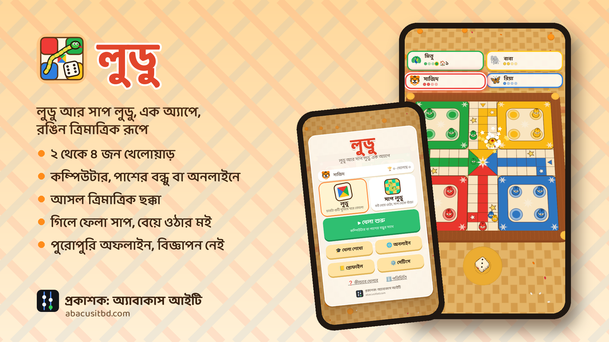

# Ludu (লুডু)

**Ludo and Snakes and Ladders, the family dice games of Bangladesh, India, Nepal, Pakistan and Sri Lanka, in one cartoon 3D app for 2 to 4 players.** Free, offline, no ads. By [Abacus IT](https://abacusitbd.com).

## Download

| Platform | Get it |
|---|---|
| **Play in the browser** (iPhone, iPad, any computer) | **[Play now](https://riadul.github.io/ludu-download/play/)** |
| **Android** 7+ | [Ludu.apk](https://github.com/riadul/ludu-download/releases/latest/download/Ludu.apk) (allow "install unknown apps" when asked) |
| **Windows** 10/11 | [Ludu-Setup-x64.exe](https://github.com/riadul/ludu-download/releases/latest/download/Ludu-Setup-x64.exe) |
| **Linux** | [Snap Store](https://snapcraft.io/ludu): `sudo snap install ludu`, or the AppImage / .deb on the [releases page](https://github.com/riadul/ludu-download/releases/latest) |

## About the game

Ludo and Snakes and Ladders are the dice games every family in South Asia grew up with: rainy afternoons, Eid and
Puja holidays, everyone round the board at grandmother's house. Now both are in one bright cartoon 3D app.

- Ludo for 2, 3 or 4 players: bring your tokens out, race them round, capture, and take all 4 home
- Snakes and Ladders for 2 to 4 players on two hand-drawn boards
- Play the computer (Easy, Medium, Hard), friends on one device, or friends online with a room code (switching on very soon)
- A real 3D dice you tap or flick; tokens that hop; snakes that swallow; ladders to climb
- House rules: need a 6 (or 1 and 6, or any number) to come out, three 6s, safe squares, bonus rolls, exact roll to 100 and more
- Profiles, statistics and places for both games, match history; saved after every turn; a short tutorial
- Fully offline, no ads, no account, no data collected; Bangla and English

**How to play:** Ludo: a 6 brings a token out; move as many squares as the dice shows; land on another player's
token to send it home; star squares are safe; the first to bring all 4 tokens into the middle wins. Snakes and
Ladders: race from 1 to 100; ladders take you up, snakes take you down.

---

## বাংলায়

**লুডু আর সাপ লুডু, আমাদের ঘরের চিরচেনা ছক্কার খেলা, এক অ্যাপে রঙিন ত্রিমাত্রিক রূপে, ২ থেকে ৪ জনে।** সম্পূর্ণ ফ্রি, অফলাইন, কোনো বিজ্ঞাপন নেই। প্রকাশক: [অ্যাবাকাস আইটি](https://abacusitbd.com)।

| কোথায় খেলবে | ডাউনলোড |
|---|---|
| **ব্রাউজারে** (আইফোন, আইপ্যাড, যেকোনো কম্পিউটার) | **[এখনই খেলো](https://riadul.github.io/ludu-download/play/)** |
| **অ্যান্ড্রয়েড** ৭ বা নতুন | [Ludu.apk](https://github.com/riadul/ludu-download/releases/latest/download/Ludu.apk) (জিজ্ঞেস করলে "অজানা অ্যাপ ইনস্টল" চালু করো) |
| **উইন্ডোজ** ১০/১১ | [Ludu-Setup-x64.exe](https://github.com/riadul/ludu-download/releases/latest/download/Ludu-Setup-x64.exe) |
| **লিনাক্স** | [স্ন্যাপ স্টোর](https://snapcraft.io/ludu): `sudo snap install ludu` |

- লুডু, ২, ৩ বা ৪ জনে: গুটি বের করো, ঘুরিয়ে আনো, কাটো, আর চারটাই ঘরে তোলো
- সাপ লুডু, ২ থেকে ৪ জনে, দুটো হাতে আঁকা বোর্ডে
- কম্পিউটারের সাথে, একই ফোনে বন্ধুদের সাথে, অথবা রুম কোড দিয়ে অনলাইনে (খুব শিগগিরই চালু হবে)
- নিজের প্রোফাইল, হিসাব আর খেলার ইতিহাস; বাংলা আর ইংরেজি

**কীভাবে খেলবে:** লুডু: ছক্কা পড়লে গুটি বের হয়; অন্যের গুটির ঘরে পড়লে সেটা কাটা পড়ে; তারা আঁকা ঘর নিরাপদ; যে আগে
চারটা গুটি মাঝখানে তোলে, সে জেতে। সাপ লুডু: ১ থেকে ১০০ পর্যন্ত দৌড়; মই উপরে তোলে, সাপ নিচে নামায়।

*Keywords: ludo, ludu, ludo game, ludo board game, snakes and ladders, snake and ladder, snakes ladders, shap ludu, sap ludu, saap ludo, sap sidi, saanp seedhi, saap seedi, chutes and ladders, pachisi, parcheesi, chaupar, chaupad, gyan chaupar, mokshapat, paramapadam, vaikunthapali, dice game, board game, family game, 2 3 4 players, offline, bangladesh, india, nepal, pakistan, sri lanka, লুডু, লুডো, সাপ লুডু, সাপ-লুডু, সাপ সিঁড়ি, পাশা, लूडो, लुडो, साँप सीढ़ी, सांप सीढ़ी, साप शिडी, पच्चीसी, चौपड़, मोक्षपट, لوڈو, سانپ سیڑھی, લુડો, સાપ સીડી, ਲੂਡੋ, ਸੱਪ ਪੌੜੀ, ଲୁଡୋ, ସାପ ସିଡ଼ି, லூடோ, பரமபதம், பாம்பு ஏணி, లూడో, వైకుంఠపాళి, పాము నిచ్చెన, ಲೂಡೋ, ಹಾವು ಏಣಿ ಆಟ, ലൂഡോ, പാമ്പും കോണിയും, ලූඩෝ*
